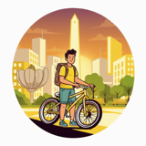
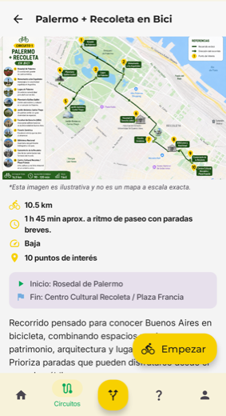
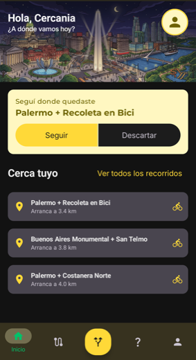
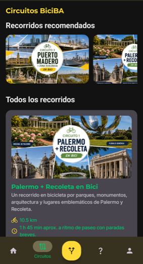
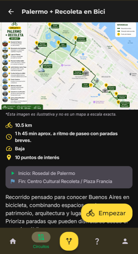
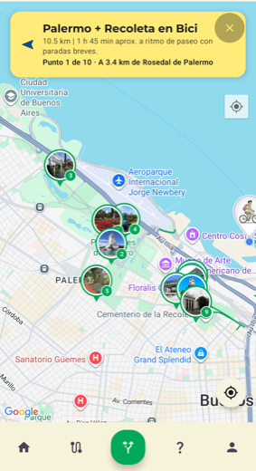

# BiciBA

**Descubrí Buenos Aires sobre dos ruedas.**

Las ciclovías de la Ciudad sobre el mapa, circuitos turísticos para recorrerlas
y una guía que te acompaña punto por punto.

 

 

 

> Este repositorio aloja **la política de privacidad** de BiciBA, publicada como página estática para
> poder enlazarla desde Google Play y desde la propia aplicación. Google Play exige una política en
> una dirección pública y estable, y vuelve a pedirla cada vez que cambia lo que la aplicación
> recoge.
>
> 👉 **[artemiod.github.io/PrivacidadBiciBa](https://artemiod.github.io/PrivacidadBiciBa/)**

 

## 📱 La aplicación

| Inicio | Circuitos | Detalle |
|:---:|:---:|:---:|
|  |  |  |
|  |  |  |

Arriba el tema claro, abajo el oscuro. El tema lo elegís vos, no el sistema.

 

| En pleno recorrido | Tu perfil |
|:---:|:---:|
|  |  |

 

## ✨ Qué hace

🗺️ **Ciclovías sobre el mapa** — las de toda la Ciudad, dibujadas sobre Google Maps y disponibles
sin conexión una vez descargadas.

🚲 **Circuitos turísticos** — cada uno con su distancia, duración estimada, dificultad y puntos de
interés, ilustrados con su propio mapa.

🧭 **Una guía que acompaña** — durante el recorrido señala hacia el próximo punto pendiente, dice a
qué distancia está y avisa al llegar. El recorrido sobrevive a cerrar la aplicación: al volver,
seguís donde quedaste.

📍 **Lo que tenés más cerca** — el inicio ordena los circuitos por cuál arranca más cerca tuyo, y el
orden no salta con cada lectura del GPS.

🌙 **Claro y oscuro** — hasta las ilustraciones cambian: de día el Obelisco al atardecer, de noche
la ciudad iluminada.

 

## 🔒 Qué datos usa, y para qué

La política no describe la aplicación en general: dice qué recoge y por qué. Esta es la
correspondencia completa.

| Dato | Función que lo necesita | Dónde queda |
|---|---|---|
| Nombre, correo e identificador | Crear la cuenta e iniciar sesión | Firebase |
| Foto de perfil | Mostrarla en el perfil, solo si subís una | Firebase Storage |
| **Ubicación** | Ubicarte en el mapa, ordenar los circuitos por cercanía y guiarte | 🔒 **Solo en tu teléfono** |
| Diagnóstico y uso | Detectar fallos y entender de forma agregada cómo se usa | Crashlytics y Analytics |
| Identificador de publicidad | Mostrar los anuncios que sostienen el proyecto | AdMob |
| Tema, recorrido en curso y mapa descargado | Recordar tu preferencia y funcionar sin conexión | 🔒 **Solo en tu teléfono** |

**La ubicación no sale del teléfono.** No se escribe en ningún servidor ni se comparte: el
dispositivo la usa mientras la aplicación está abierta y ahí termina. Tampoco se accede a ella en
segundo plano.

Podés **eliminar tu cuenta vos mismo** desde la aplicación, en *Perfil → Eliminar cuenta*.

 

## 🛠️ Sobre esta página

`index.html` es la página entera: sin dependencias, sin compilación, se abre tal cual. Se sirve con
GitHub Pages desde la rama `main`.

La política describe lo que la aplicación hace de verdad, así que **se actualiza junto con la app**:
al agregar un permiso, un SDK que procese datos o una función que guarde algo nuevo, hay que
reflejarlo acá y cambiar la fecha de "Última actualización". La tabla de arriba es la que conviene
repasar en cada cambio.

 

## 📬 Contacto

Dudas sobre el tratamiento de datos, o cualquier consulta sobre la aplicación:
**artemio.dev.mobile@gmail.com**

 

---

BiciBA es un proyecto independiente · Hecho para disfrutar Buenos Aires sobre dos ruedas 🚲

